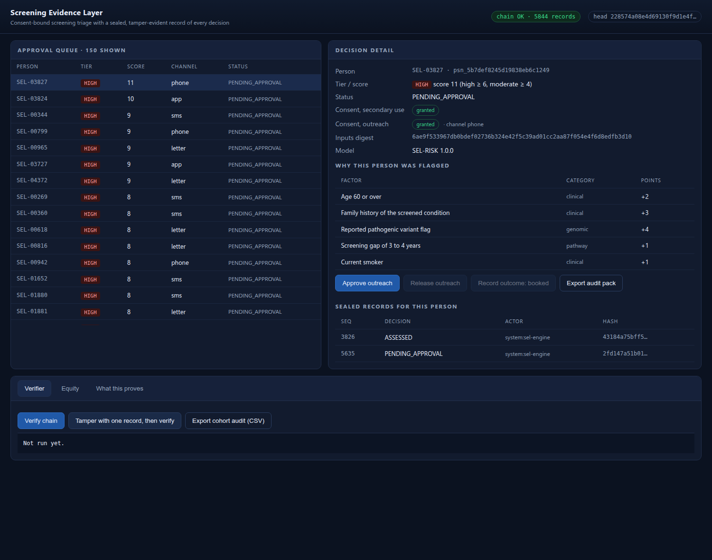
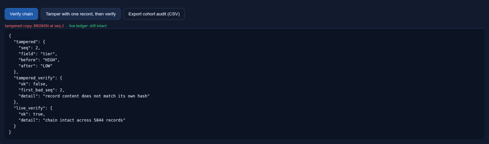

# TriageTek


**Screening evidence infrastructure for population health programmes.**

TriageTek is a working prototype for the **Future Health Digital Innovation Challenge** (Challenge 04,
Precision Prevention and Screening), GITEX Dubai 2026.

It does not try to out-model anyone. It answers the question a screening
programme cannot answer today: **can you prove what happened to this person's data and this
person's decision, six months later, to an auditor who was not in the room?**

Every step is sealed into an append-only hash chain. Change one field in one record and
verification fails at that record.

*TriageTek for the Future Health Digital Innovation Challenge: consent first, human approval, every decision preserved.*


## Hybrid post-quantum evidence

A hash chain proves a record was not edited. It does not prove who wrote it, because anyone
with write access can rebuild the whole chain. TriageTek's optional hybrid profile signs every
record twice, once with Ed25519 and once with ML-DSA-65 (FIPS 204), and the verifier requires
both halves.

Ed25519 signs each record. ML-DSA-65 signs a Merkle root every 250 records, so every record
inherits the post-quantum guarantee without paying 10 ms per record. If either algorithm falls,
the other one still carries the evidence, and a record sealed today is designed to keep
verifying after the classical algorithms are retired.

| Claim | Observed on this build |
|---|---|
| Records sealed | 5,867, of which 5,841 signed |
| Checkpoints | 25 ML-DSA-65 signed Merkle roots |
| Hybrid verification | `both signature halves verify across 5,841 records in 25 checkpoints` |
| Forged copy, signatures stripped, hashes recomputed | chain `OK`, signatures `FAILED` |
| Cycle runtime | 0.354 s unsigned, 0.716 s hybrid |
| Tests | 37 passed |

```bash
pip install -r requirements-pqc.txt
python3 -m sel.hybrid --data-dir data-hybrid --fresh
python3 -m sel.verify --ledger data-hybrid/ledger.jsonl
python3 -m sel.forge --ledger data-hybrid/ledger.jsonl --out data-hybrid/forged.jsonl --field tier --value LOW
python3 -m sel.verify --ledger data-hybrid/forged.jsonl   # exits 1, names the failing half
SEL_DATA=data-hybrid SEL_HYBRID=1 python3 server.py --port 8795   # /api/verify reports both halves
```

Design, threat model and the published signing benchmark: [docs/HYBRID-PQC.md](docs/HYBRID-PQC.md).
How it is built, for engineers: [docs/TECHNICAL-ANNEX.md](docs/TECHNICAL-ANNEX.md).

## Quick start

```bash
git clone https://github.com/narko4u/triage-tek && cd triage-tek
python3 server.py --port 8795
# open http://127.0.0.1:8795
```

No dependencies for the default profile, no network calls, no accounts. Python 3.11+.
The hybrid profile adds one optional extra, listed in `requirements-pqc.txt`.

```bash
python3 -m pytest tests -q                    # 37 tests with the extra, 24 without
python3 -m sel.verify --ledger data/ledger.jsonl --chain-only   # default profile is unsigned
python3 -m sel.tamper --ledger data/ledger.jsonl --out data/tampered.jsonl --field tier
python3 -m sel.verify --ledger data/tampered.jsonl --chain-only # exits 1, names the bad record
```

### Run it as a container

```bash
docker build -t triage-tek .
docker run --rm -p 8080:8080 triage-tek
# open http://127.0.0.1:8080
```

The image carries no data and no secrets. The ledger is deterministic from seed `20261120`, so the
process seals its own cycle at boot. `SEL_DEMO_RESET_SECONDS=1800` rebuilds the ledger every 30
minutes, which is how the hosted demo stays clean between visitors; set it to `0` to keep one
record for the life of the process.

## What it does

1. **Generates a synthetic cohort** of 5,000 people from a fixed seed, so the run reproduces
   byte for byte. No real person, no real record, no genomic data from anyone real.
2. **Scores each person** with a published, transparent points system (`SEL-RISK 1.0.0`).
   The score is decomposed at decision time into named factors, points and observed values.
3. **Applies consent before action.** No secondary use without consent. No outreach without
   outreach consent. A consent-blocked person cannot be approved by any role, because the
   transition is refused by the engine, not by the interface.
4. **Requires human approval** before any contact is released. The approver's identity, role
   and note are sealed with the decision.
5. **Seals every transition**: ASSESSED, NO_ACTION, CONSENT_BLOCKED, PENDING_APPROVAL,
   APPROVED, OUTREACH_RELEASED, OUTCOME.
6. **Verifies on demand**, and exports a per-person audit pack or a cohort-wide CSV.

## What it looks like

*Approval queue on the left, the sealed decision record on the right. Every row is a synthetic person; every transition is sealed.*



*After the tamper test: the edited copy fails at record 2, the live ledger still verifies clean.*



## Measured on this build

| Claim | Observed |
|---|---|
| Records sealed | 5,841 across 5,000 people, 5,867 with hybrid checkpoints |
| Chain verification | `chain intact across 5,867 records` |
| Tamper test | edited record 2, `HIGH` to `LOW`; verifier `BROKEN at seq 2` |
| Live ledger after tamper test | still intact (the test runs on a copy) |
| Tests | 24 without the extra, 37 with it |
| Cycle runtime | 0.354 s for 5,000 assessments, 0.716 s hybrid |

Numbers above are from an actual run on this machine, not estimates. Regenerate them with
the commands in Quick start.

## Honest limits

The cohort is synthetic. The risk model is illustrative and uncalibrated. There is no
clinical validation and no outcome claim. The bare hash chain is tamper-**evident**, not
tamper-proof: someone with write access can rewrite it from the edit forward. The hybrid
profile closes that, because a rewrite needs the signing keys, but it moves the trust question
to key custody rather than deleting it. Full list in
[docs/LIMITATIONS.md](docs/LIMITATIONS.md).

## Layout

```
sel/
  sel/canonical.py   canonical JSON + sha256
  sel/ledger.py      append-only hash-chained ledger
  sel/pqc.py         hybrid signing: Ed25519 per record, ML-DSA-65 checkpoints
  sel/hybrid.py      hybrid profile runner and signing benchmark
  sel/forge.py       the forgery the signature layer is built to catch
  sel/cohort.py      seeded synthetic cohort
  sel/risk.py        transparent points model
  sel/engine.py      pathway state machine, rebuilt from the ledger on restart
  sel/verify.py      CLI verifier
  sel/tamper.py      tamper harness (works on a copy)
  server.py          stdlib HTTP server, no dependencies
  web/index.html     demo interface
  tests/             37 tests, 13 of them for the hybrid profile
  data/              generated cohort and ledger
  docs/              architecture, limits, demo script, rubric map
```

## Licence and attribution

MIT. Built by Security Division, Empire Labs Pty Ltd.
